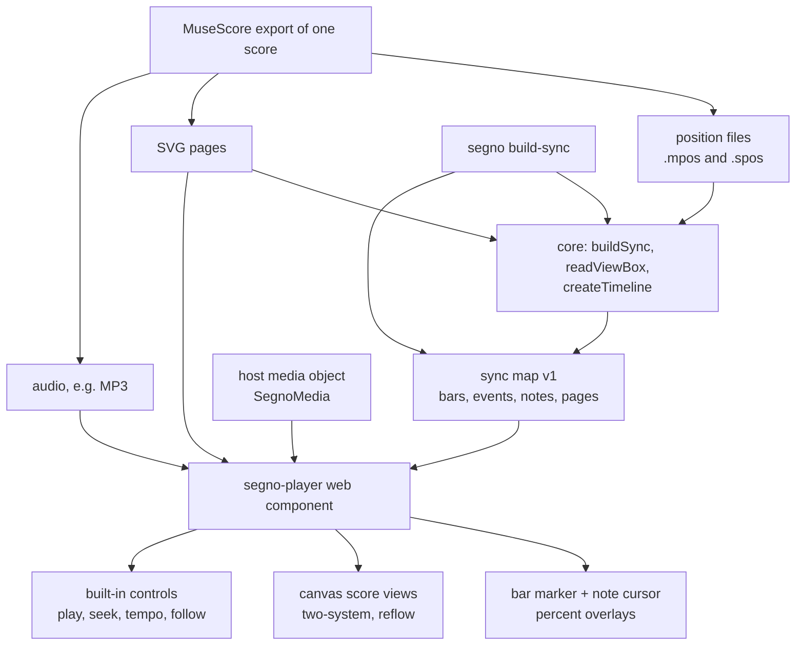
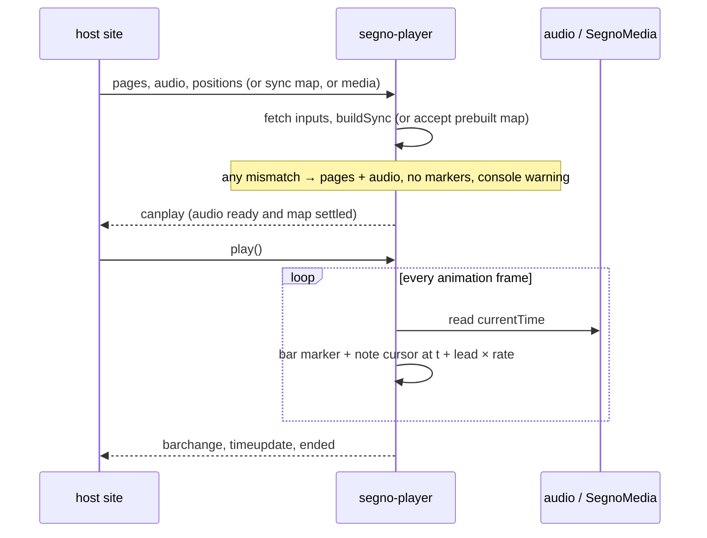
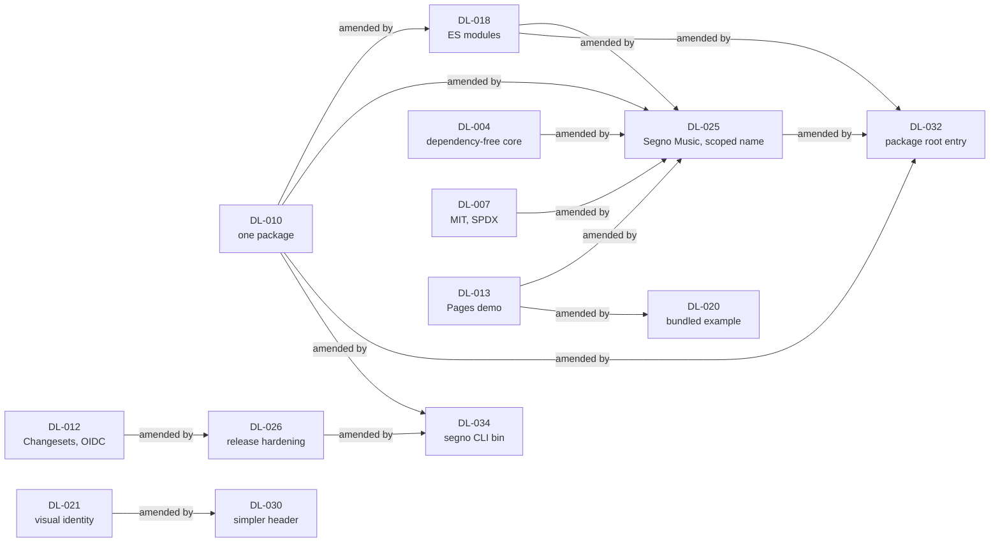
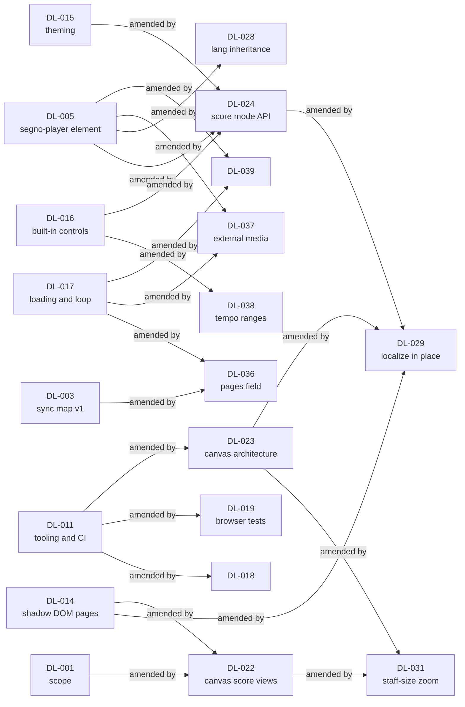

# System Overview

> Auto-generated narrative synthesis from 39 active decisions. Last updated 2026-11-21.
> This document is derived from individual decision records — do not edit manually.
> Use `/dld-snapshot` to regenerate.

## Architecture Overview

Segno is a score player for the web. It takes a single MuseScore export of a score — the engraved SVG pages, the audio rendering, and the `.mpos`/`.spos` position files — and follows the audio on the original pages with a bar marker and a note cursor. A dependency-free core turns the position files into a compact **sync map**; the `<segno-player>` web component consumes the map (built in the browser, or prebuilt by the `segno build-sync` CLI) and drives markers, canvas score views, controls and follow-scrolling over the score's own audio or a host-provided media object.

## Scope and inputs

Segno's scope is deliberately narrow: it plays a score's own audio on the score's own engraved pages and follows along — it never renders, edits, transposes or converts notation (DL-001). Everything rests on one bet: MuseScore can export, from one score, everything a player needs. Its `.mpos` and `.spos` position files carry bar boxes, note positions and every event in **playback order**, and that unrolled order is the truth — Segno has no repeat, jump or tempo logic of its own (DL-002). `buildSync` validates that the files belong together and turns them, plus each page's `viewBox`, into **sync map version 1**: a few KB of JSON tuples holding bar boxes, event times and note positions as fractions of the page (DL-003). Version 1 later gained an optional `pages` field — each page's size as read from the `viewBox` — so prebuilt maps arrive knowing their aspect ratios and the layout never jumps while images load (DL-036).

The core that does this has no runtime dependencies and touches no DOM or Node API, so the same code builds maps at build time in Node and in the browser (DL-004). On top of the map, `createTimeline` answers the player's questions: what plays now, where the note cursor should be (it glides evenly between notes and runs on to the barline at a line's end), which bar was clicked, and where to seek inside a repeat — always the pass nearest the current position (DL-009).

## The web component

`<segno-player>` is a framework-free custom element: a script tag and the element, and the pages play (DL-005). Its API deliberately mirrors `HTMLMediaElement` — `currentTime`, `duration`, `playbackRate`, `play()`, `pause()`, the media events — extended with what a score player uniquely needs: `barchange`, `currentBar`, `playBar(index)` and the `sync` map. Sites give it file URLs (it fetches and builds the map itself) or a prebuilt map; hosts that bring their own engine hand it a media object instead (see *External media* below).

Inside, the player renders into an open shadow root: each SVG page as an `` with an overlay of percent-positioned markers, so markers stay on their bars at any size (DL-014). The marker design was tuned by ear on real scores: a static bar-marker tint (7% of the accent colour) that crossfades between bars, and a thin note cursor that moves every frame, plus configurable leads of +15 ms and −20 ms scaled by the playback rate (DL-006). Sites theme everything through `--segno-*` custom properties and stable `::part()` names; the player is a size container, and style-query presets like `--segno-controls: compact` switch coordinated looks with graceful degradation (DL-015). The built-in controls — native play, restart, seek, tempo stepper and follow checkbox — appear only with the `controls` attribute, collapse settings behind a button below 44rem, and support keyboard shortcuts with polite current-bar announcements (DL-016).

Loading is forgiving by design: every input change starts a fresh, cancellable load; the player never blocks playback on the markers, and any mismatch — a map that fails to build, an unknown format version, audio shorter than the last event — falls back to plain pages-and-audio playback with a console warning (DL-017). While playing, a `requestAnimationFrame` loop reads `currentTime` each frame and places the markers; with `follow`, the player scrolls the playing system into view. The audio-length check later learned to tolerate a silent last bar: only a shortfall reaching the second-to-last event counts as "Play repeats was off", and at the media's end the markers show the final bar (DL-039).

For framework integrations, the element's attributes are typed once as the exported `SegnoPlayerAttributes`, with copy-paste registration snippets for React, Vue, Svelte and Angular in the README — no wrapper packages (DL-033).

## Canvas score views

Full engraved pages become hard to read on phones, so the player gained alternative **score views** that crop and recombine the original engraving without moving a single symbol: *two-system* crops pages around engraved system pairs, *reflow* recombines bar regions into rows at a locked scale, and *full score* remains the default and the canonical rendering (DL-022). Rendering is split cleanly: a pure layout module computes systems, crops, reflow rows and projections with no DOM or audio access, while `CanvasView` owns resizing, SVG decoding and a lazy, memory-bounded per-page raster cache; the element stays the sole media and timeline orchestrator, and the existing DOM marker overlays float above the canvas through layout projections (DL-023).

Views are selected through a public `mode` attribute — `full`, `two-system`, `reflow` or `auto` — where `auto` uses a `ResizeObserver` on the player's host width (768 px threshold) so adaptation responds to the actual container, not the device (DL-024). Zoom is calibrated from the engraving itself: staff-line spacing (with a matching `BarLine` extent) yields a median staff height that sets one score-wide content width of 15 staff heights, and SVG lyric geometry extends system bottoms — so equal engraved staff sizes render at equal size regardless of bar widths (DL-031).

## External media and tempo

Segno never contains a synthesizer. Instead, a host can set `player.media` to any object with the `SegnoMedia` shape — a small subset of `HTMLMediaElement` — and the player routes everything through it: same loop, same events, same readiness contract (DL-037). Swapping media while playing keeps the position, rate and playing state, so a host can start on the MP3 and switch to a SoundFont synthesizer (which changes tempo by scheduling rather than stretching, keeping slow playback clean) and back if it fails. Tempo, in turn, is configurable: `tempo-min`/`tempo-max`/`tempo-step` bound the built-in stepper only, the internal `<audio>` is clamped to 0.25–2× while external media gets the full range, `tempo-base` shows the tempo as "♩ = N" quarter notes per minute, and `webkitPreservesPitch` keeps pitch on older iOS (DL-038).

## Localization

The player ships typed English and Swedish dictionaries — one catalog per language, complete by construction, with whole-phrase formatter functions instead of concatenated fragments (DL-027). Language comes from standard HTML: the player's own `lang` wins, otherwise it inherits through ancestors (shadow hosts included), with regional tags and case matched via the native `:lang()` selector; anything unsupported falls back to English deterministically (DL-028). A language change updates all control text, ARIA labels, descriptions and announcements **in place** — no DOM rebuilt, no assets reloaded, playback state, focus and slotted controls preserved (DL-029).

## Packaging and the CLI

The package story evolved in three steps. It began as one ESM package with subpath exports and no root export (DL-010); the player shipped as plain `tsc`-built ES modules with no bundler, loaded from a CDN as-is (DL-018); then the project moved under the **Segno Music** organization as `segnomusic/segno-player` with the npm package `@segnomusic/player` (DL-025) — and in 0.3.0 the component moved to the package root, retiring the redundant `./player` subpath in a clean pre-1.0 break (DL-032).

The `segno` CLI ships as a bin in the same package, staying an ordinary consumer of the public core entry so the core remains DOM-free and Node-free (DL-034). Its first command, `segno build-sync`, finds an export by name (`.mpos`, optional `.spos`, pages counted up from `-1.svg` — never globbed, so page order survives past page 9), builds the sync map, and is strict about mismatches: a build step should fail loudly where the browser would play on without a note cursor (DL-035).

## Tooling, release and demo

Quality is enforced automatically: strict TypeScript (with `noUncheckedIndexedAccess` and friends), Biome for lint and format, Vitest with a 90% coverage floor that only goes up, gzipped size budgets per entry point, SPDX header checks, and GitHub Actions on Node 22 and 24 with SHA-pinned third-party actions (DL-011). Browser tests run the element where it lives — Vitest's browser mode in Chromium — sharing one merged coverage number with the Node core tests, using synthetic blank pages and generated silent audio instead of real scores (DL-019).

Releases use Changesets for versioning and npm trusted publishing (OIDC with provenance, no stored token) (DL-012), hardened with full validation of version candidates and packed tarballs, lockfile updates during versioning, and a one-time local bootstrap publish for 0.1.0 (DL-026). The demo and per-pull-request previews live on GitHub Pages from the `gh-pages` branch, with relative asset paths so one build serves both (DL-013). It loads a bundled open-licensed example (*När juldagsmorgon glimmar*, Fria Noter, CC BY 4.0) and lets visitors try their own export entirely client-side (DL-020), dressed in the Segno identity: an engraved segno sign standing in as the capital S of the `𝄋egno` wordmark, Archivo and IBM Plex typography, and a Swiss archival-paper palette (DL-021) — later simplified by dropping the decorative header rule (DL-030).

Ground rules keep the project adoptable and redistributable: MIT with inbound = outbound contribution terms and SPDX headers on every file, and no MuseScore code ever copied in (DL-007); no trademark in names, and only open-licensed fixture scores listed with their sources (DL-008).

## Decision Relationships

Amendment chains — most notably the packaging lineage (DL-010 → DL-018 → DL-025 → DL-032) and the canvas-view line (DL-022 → DL-031, DL-023 → DL-029):

## Key Technical Choices

- **Play, don't render:** MuseScore's exports (engraved pages, audio, position files) are the only input; notation is never interpreted (DL-001, DL-002).
- **Sync map v1:** a documented, versioned JSON format of page-fraction tuples, embeddable at ~2 KB, carrying page sizes since DL-036 (DL-003).
- **Dependency-free, DOM-free, Node-free core**, compiled against the ES2023 lib so violations fail the build (DL-004).
- **`<segno-player>` with an `HTMLMediaElement`-shaped API** — familiar, framework-free, no build step on the site (DL-005).
- **Shadow DOM + percent overlays**, `--segno-*` custom properties and parts as the theming API (DL-014, DL-015).
- **Canvas score views with engraving-relative zoom** for mobile reading, layout as pure math (DL-022–024, DL-031).
- **External media contract instead of built-in synthesis**, keeping the size budget and scope intact (DL-037).
- **One ESM package (`@segnomusic/player`), component at the package root, no bundler**; the `segno` CLI ships in it (DL-010, DL-018, DL-025, DL-032, DL-034).
- **Strict TS, Biome, Vitest browser mode, 90% coverage floor, size budgets, all in CI** (DL-011, DL-019).
- **Changesets + npm OIDC trusted publishing**, with validated packed tarballs (DL-012, DL-026).
- **MIT with SPDX headers, no trademark names, open-licensed fixtures** (DL-007, DL-008).
